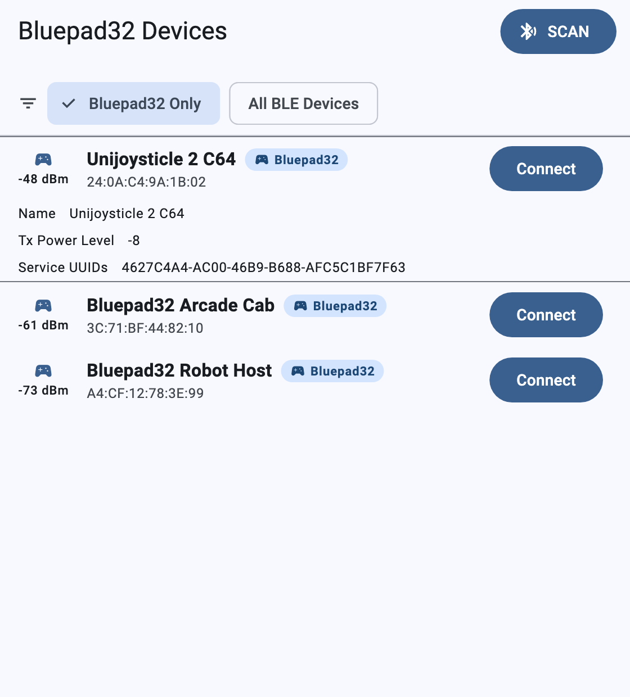
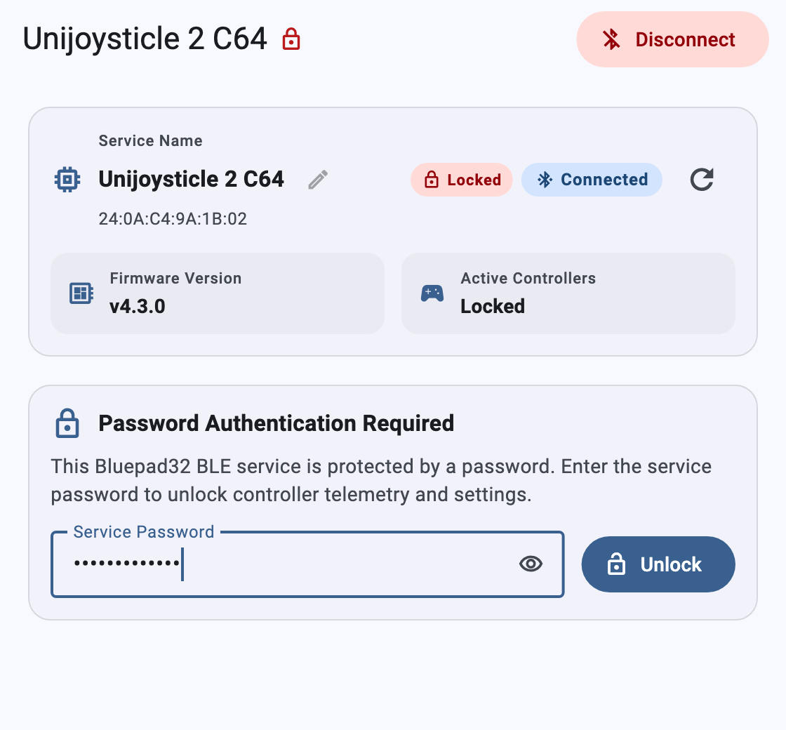
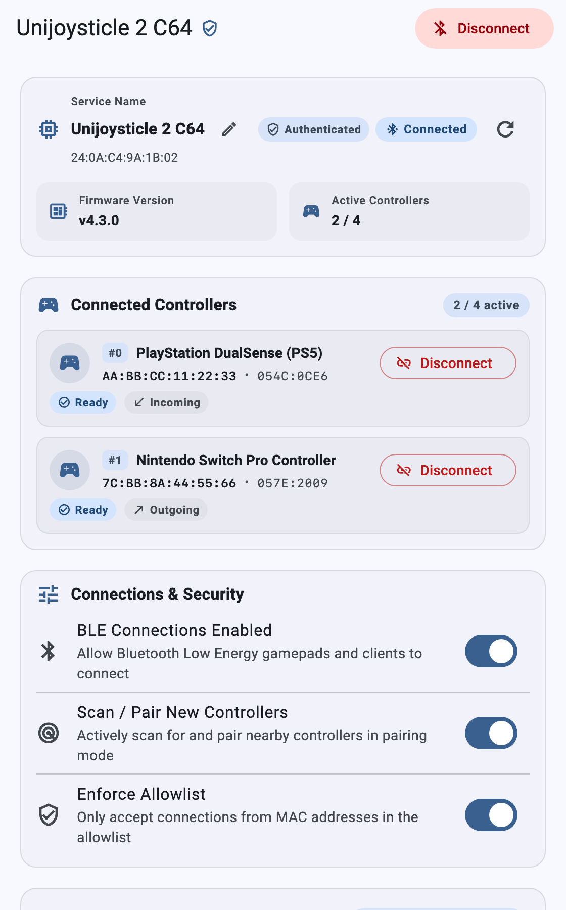
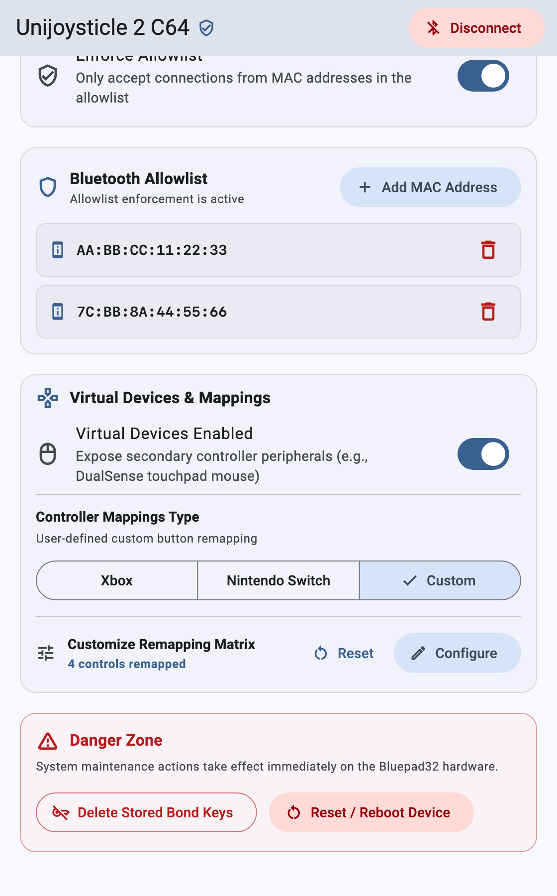
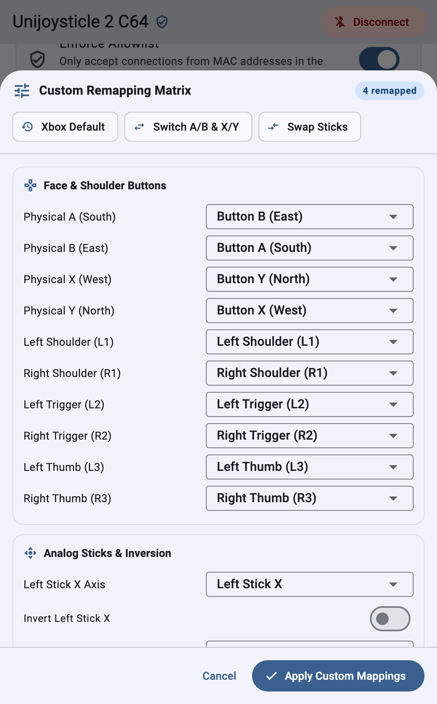

# Bluepad32 BLE Client

A cross-platform Flutter companion app that configures and monitors
[Bluepad32](https://github.com/ricardoquesada/bluepad32) devices over Bluetooth
Low Energy (BLE).

It connects to the Bluepad32 BLE GATT service
(`4627C4A4-AC00-46B9-B688-AFC5C1BF7F63`). Use it to inspect connected gamepads
and update runtime settings without a serial console or firmware reflash.

## Features

* **Device Discovery & Custom Service Identity (`AC0D`):** Scans for nearby
    Bluepad32 BLE peripherals. It prioritizes live `ADV_IND` + `SCAN_RSP`
    advertising names over cached OS names and supports inline renaming (`1–29`
    UTF-8 bytes).
* **Session Password Authentication (`AC0E`):** Supports password-protected
    Bluepad32 peripherals (`1–31` UTF-8 bytes). The client prompts you to unlock
    the BLE session before it reads or updates protected settings.
* **Live Controller Monitor (`AC05`, `AC0A`):** Shows connected controllers in
    real time (model, MAC address, Vendor/Product ID, and state). You can
    disconnect individual slots remotely (`AC0A`).
* **Radio & Pairing Controls (`AC03`, `AC04`, `AC09`, `AC10`):** Toggles controller
    scanning, BLE controller connections, virtual child devices (such as
    DualShock 4 and DualSense touchpad mice), and allowed HID device categories
    (**Gamepads**, **Mice**, **Keyboards**).
* **Controller Button Mappings & Custom Remapping Matrix (`AC06`, `AC0F`):**
    Selects **Xbox**, **Nintendo Switch**, or **Custom** presets (`AC06`). The
    interactive **Custom Remapping Matrix** editor (`AC0F`) configures all 28
    fields of `uni_gamepad_mappings_t`.
* **Bluetooth MAC Allowlist (`AC07`, `AC08`):** Enables or disables allowlist
    enforcement. You can add or remove up to 4 allowed controller MAC addresses.
* **System Maintenance (`AC0B`, `AC0C`):** Clears stored Bluetooth pairing keys
    or reboots the Bluepad32 microcontroller remotely.

## Supported Platforms

Built with Flutter and [`flutter_blue_plus`](https://pub.dev/packages/flutter_blue_plus):

* **Android** (API 21+)
* **iOS** (iOS 12+)
* **macOS** (macOS 10.14+, Universal `x86_64` + `arm64`)
* **Linux** (`x64` and `arm64`, requires `bluez`)
* **Windows** (Windows 10+ `x64` via WinRT BLE)
* **Web** (experimental, requires Chrome or Edge with Web Bluetooth support)

## Screenshots

| Device Discovery (`ScanScreen`) | Password Authentication (`AC0E`) |
| :---: | :---: |
|  |  |

| Connected Controllers & Radio Settings (`AC01`–`AC05`, `AC07`) | Allowlist, Mappings & Maintenance (`AC06`–`AC09`, `AC0B`, `AC0C`) |
| :---: | :---: |
|  |  |

| Interactive 28-Field Custom Remapping Matrix (`AC0F`) |
| :---: |
|  |

## How to Use

### 1. Enable the BLE Service on Your Bluepad32 Device

Before you connect with the client app, enable the BLE configuration service
(`uni_bt_service.c`) on your Bluepad32 board:

* **ESP32 Serial Console (`idf.py monitor`):**

    ```sh
    # Enable and advertise the BLE configuration service
    ble_service_enable 1

    # (Optional) Set the advertised BLE device name (1..29 UTF-8 bytes)
    ble_service_name "Unijoysticle 2 C64"

    # (Optional) Set a session password (1..31 UTF-8 bytes, or 'none' to clear)
    ble_service_password "arcade-secret"
    ```

* **Bluepad32 C API:**

    ```c
    #include "bt/uni_bt.h"
    #include "bt/uni_bt_service.h"

    // Inside on_init_complete() on the BTstack thread:
    uni_bt_service_set_name("Unijoysticle 2 C64");
    uni_bt_service_set_password("arcade-secret"); // or NULL / "" for open access
    uni_bt_service_set_enabled(true);

    // Or from any external thread / FreeRTOS task:
    uni_bt_enable_service_safe(true);
    ```

### 2. Discover and Connect to a Bluepad32 Device

1.  Open **Bluepad32 BLE Client**. You can download a prebuilt binary from
    [GitHub Releases](https://github.com/ricardoquesada/bluepad32-ble-client/releases)
    or build from source.
2.  Select the **Bluepad32 Only** filter chip. Tap **SCAN**.
3.  Tap a device row to inspect its RSSI, TX power level, and service UUID
    (`4627C4A4-AC00-46B9-B688-AFC5C1BF7F63`).
4.  Tap **Connect** to open the configuration dashboard.

### 3. Unlock a Password-Protected Session (If Enabled)

If the Bluepad32 peripheral requires a session password (`AC0E`), the dashboard
shows a **Locked** badge. Enter the password (`1–31` UTF-8 bytes) and tap
**Unlock** to authenticate the session.

### 4. Monitor Controllers and Update Runtime Settings

* **System Info (`AC01`, `AC02`, `AC0D`, `AC0E`):** Shows the firmware version
    and active controller slot count (`2 / 4`). Tap the edit icon to rename the
    BLE service (`1–29` UTF-8 bytes), or tap the refresh icon to re-read all
    GATT characteristics.
* **Connected Controllers (`AC05`, `AC0A`):** Shows connected gamepads in real
    time (slot index, model name, Bluetooth MAC address, `VID:PID`, state, and
    direction). Tap **Disconnect** on any slot to disconnect that controller.
* **Connections & Security (`AC03`, `AC04`, `AC07`, `AC10`):** Toggles **BLE
    Connections Enabled**, **Scan / Pair New Controllers**, **Enforce
    Allowlist**, and **Allowed HID Device Types** (**Gamepads**, **Mice**,
    **Keyboards**).
* **Bluetooth Allowlist (`AC08`):** Tap **+ Add MAC Address** to add an allowed
    controller MAC address (`AA:BB:CC:DD:EE:FF`). Tap the trash icon to remove
    an existing entry.
* **Virtual Devices & Mappings (`AC06`, `AC09`, `AC0F`):**
    * Toggle **Virtual Devices Enabled** (such as the DualSense or DualShock 4
        touchpad mouse).
    * Select the **Xbox**, **Nintendo Switch**, or **Custom** layout preset.
    * Tap **Configure** next to **Customize Remapping Matrix** to open the
        28-field remapping editor (`AC0F`). You can load quick presets (**Xbox
        Default**, **Switch A/B & X/Y**, **Swap Sticks**) or remap individual
        buttons, axes, inversions, D-pad directions, and triggers.
* **Danger Zone (`AC0B`, `AC0C`):** Tap **`Delete Stored Bond Keys`** to clear
    all saved Bluetooth keys. Tap **`Reset / Reboot Device`** to restart the
    microcontroller.

## Building and Deploying

The `src/` directory contains all Flutter project files:

```bash
cd src
flutter pub get
```

### Run in Development Mode

List connected targets with `flutter devices`, then run on your target device:

```bash
# Run on a connected Android or iOS device
flutter run -d <device_id>

# Run on macOS desktop
flutter run -d macos

# Run on Linux desktop
flutter run -d linux

# Run on Windows desktop
flutter run -d windows

# Run on Chrome (Web Bluetooth)
flutter run -d chrome
```

### Build & Deploy Release Binaries

* **Android (APK / App Bundle):**

    ```bash
    flutter build apk --release
    flutter build appbundle --release
    flutter install -d <android_device_id>
    ```

* **iOS:**

    ```bash
    flutter build ios --release
    flutter install -d <ios_device_id>
    ```

    *(Requires Xcode and an Apple Developer signing team in
    `src/ios/Runner.xcworkspace`.)*

* **macOS:**

    ```bash
    flutter build macos --release
    open build/macos/Build/Products/Release/Bluepad32.app
    ```

* **Linux:**

    ```bash
    flutter build linux --release
    ./build/linux/x64/release/bundle/bluepad32
    ```

* **Windows:**

    ```bash
    flutter build windows --release
    .\build\windows\x64\runner\Release\bluepad32.exe
    ```

* **Web:**

    ```bash
    flutter build web --release
    ```

## Creating a Release

The [`.github/workflows/release.yml`](.github/workflows/release.yml) workflow
builds and publishes releases automatically when you push a `v*` tag to GitHub:

```bash
git tag v1.2.0
git push origin v1.2.0
```

The workflow extracts the semantic version from the tag (`v1.2.0` ->
`--build-name=1.2.0`). It sets an integer build number
(`--build-number=${{ github.run_number }}`, or `N` if the tag ends with `+N`
such as `v1.2.0+42`).

### Manual Dry-Run (`workflow_dispatch`)

To test the release build pipeline without creating a GitHub tag or GitHub
Release, trigger the workflow manually:

* **GitHub Web UI:** Open **Actions -> Release -> Run workflow**, select the
    `main` branch, and click **Run workflow**.
* **GitHub CLI (`gh`):**

    ```bash
    gh workflow run release.yml --ref main
    ```

Manual `workflow_dispatch` runs build all platform targets with fallback version
`1.0.0+${{ github.run_number }}`. The workflow attaches the packaged binaries as
run artifacts on the GitHub Actions summary page.

### Published Release Assets

| Platform | Release Asset | Notes |
| :--- | :--- | :--- |
| **Android (APK)** | `bluepad32-android.apk` | Direct sideloadable Android package |
| **Android (App Bundle)** | `bluepad32-android.aab` | Google Play Console upload bundle |
| **iOS** | `bluepad32-ios.ipa` | App Store Connect (`Transporter`) / sideload IPA archive |
| **macOS (Universal)** | `bluepad32-macos-universal.zip` | Universal (`x86_64` + `arm64`) `Bluepad32.app`, signed (`Developer ID Application`), notarized, and stapled |
| **Linux (x64)** | `bluepad32-linux-amd64.tar.gz` | GTK desktop bundle (`bluepad32`) for `x86_64` |
| **Linux (ARM64)** | `bluepad32-linux-arm64.tar.gz` | GTK desktop bundle (`bluepad32`) for `aarch64` |
| **Windows (x64)** | `bluepad32-windows-amd64.zip` | Win32/WinRT desktop bundle (`bluepad32.exe`) for `x86_64` |
| **Web** | `bluepad32-web.tar.gz` | Static Web Bluetooth PWA bundle |

### GitHub Actions Secrets for Code Signing & Notarization

* **macOS Code Signing & Apple Notary Service (Required for macOS release job):**
    * `MACOS_CERTIFICATE`: Base64-encoded `Developer ID Application` `.p12`
        certificate.
    * `MACOS_CERTIFICATE_PWD`: Password for the macOS `.p12` certificate.
    * `KEYCHAIN_PWD`: Temporary CI keychain password.
    * `APPLE_ID`: Apple ID email address for `xcrun notarytool`.
    * `APPLE_PASSWORD`: App-specific password for `xcrun notarytool`.
    * `APPLE_TEAM_ID`: 10-character Apple Developer Team ID.
* **Android Release Keystore Signing (Optional, falls back to debug signing if omitted):**
    * `ANDROID_KEYSTORE_BASE64`: Base64-encoded Android upload keystore (`.jks`
        or `.keystore`).
    * `ANDROID_STORE_PASSWORD`: Keystore password.
    * `ANDROID_KEY_ALIAS`: Key alias inside the keystore.
    * `ANDROID_KEY_PASSWORD`: Private key password.
* **iOS App Store Distribution Signing (Optional, falls back to unsigned `.ipa` if omitted):**
    * `IOS_CERTIFICATE`: Base64-encoded `Apple Distribution` `.p12` certificate.
    * `IOS_CERTIFICATE_PWD`: Password for `IOS_CERTIFICATE`.
    * `IOS_PROVISION_PROFILE`: Base64-encoded App Store `.mobileprovision`
        profile for `moe.retro.bluepad32`.
    * `KEYCHAIN_PWD`: Temporary CI keychain password (shared with macOS).
    * `APPLE_TEAM_ID`: 10-character Apple Developer Team ID (shared with macOS).

### Running Tests & Static Analysis

Run static analysis and the automated unit and widget test suite from the `src/`
directory:

```bash
cd src

# Run Dart static analysis and lint checks
flutter analyze

# Run the full unit and widget test suite
flutter test

# Run individual test suites
flutter test test/bluepad32_models_test.dart     # Domain models, binary serialization, and Bluepad32Client GATT service layer
flutter test test/bluepad32_dashboard_test.dart  # DeviceScreen and Material 3 configuration dashboard cards
flutter test test/scan_and_tiles_test.dart       # BLE discovery screen (ScanScreen) and peripheral tiles (ScanResultTile, SystemDeviceTile)
flutter test test/utils_test.dart                # Stream re-emission (StreamControllerReemit), Snackbar, and BluetoothDevice Extra utilities
flutter test test/widget_test.dart               # App routing (FlutterBlueApp), BluetoothOffScreen, and adapter state observer

# Generate LCOV line coverage report (outputs src/coverage/lcov.info)
flutter test --coverage
```
